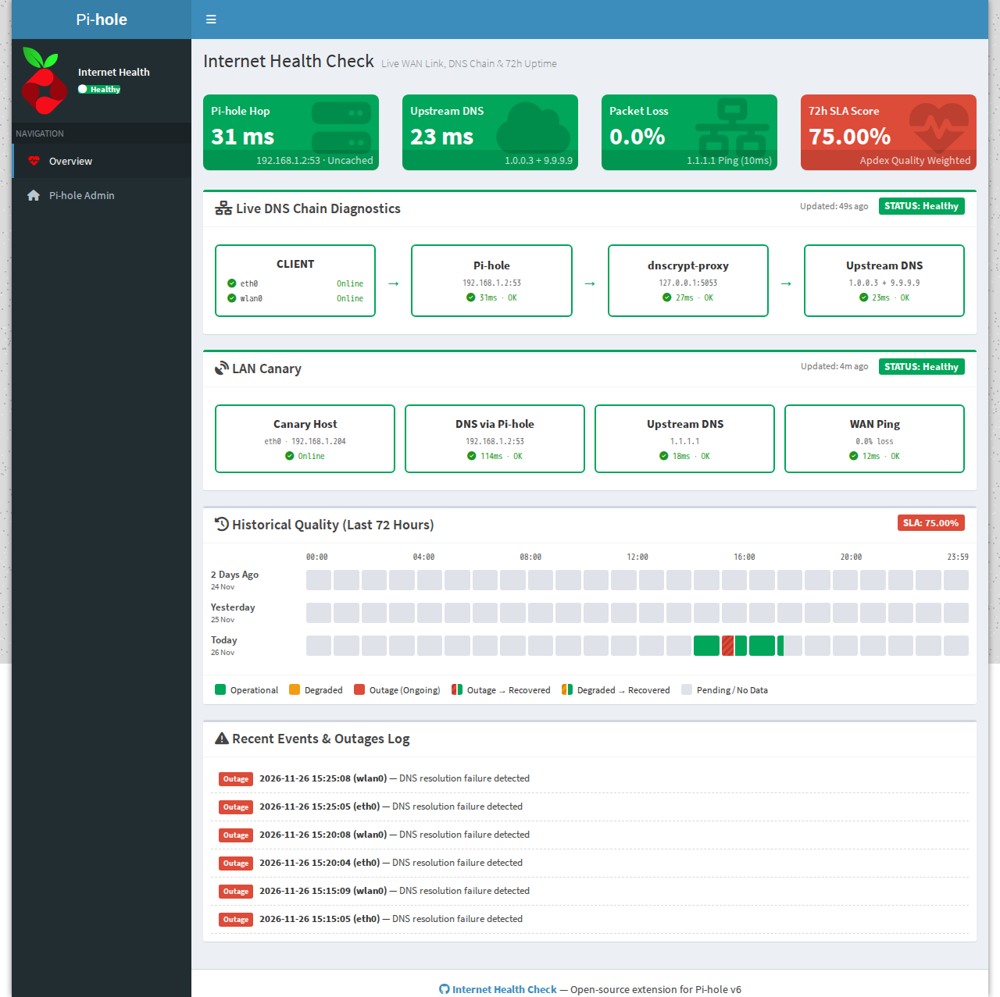

# Internet Health Check

Lightweight telemetry monitor for internet connectivity and DNS chain health on Linux, Raspberry Pi OS, and macOS. Features a web dashboard styled to match Pi-hole v6, zero-disk-wear RAM state tracking, 72-hour historical SLA grid, and real-time CLI diagnostics.

[](https://github.com/psinx/InternetHealthCheck/releases)
[](LICENSE)

<p align="center">
  
</p>

---

## Features

* **Native Pi-hole v6 AdminLTE UI**: Matches Pi-hole's web interface with automatic dark and light theme switching (`prefers-color-scheme`) and 4 top KPI cards (`Pi-hole Hop`, `Upstream DNS`, `Packet Loss`, Apdex-weighted `72h SLA Score`).
* **Multi-Hop DNS Chain Diagnostics**: Dedicated 2-line chain nodes across Client (`eth0`, `wlan0`), Pi-hole, dnscrypt-proxy, and Upstream DNS (primary + secondary failover), plus contextual **Recommended Actions** remediation guidance.
* **Standalone LAN Canary Tile**: Optional remote client view (auto-displayed when a secondary host pushes `canary_status.json` via SSH stdin) showing `Canary Host`, `DNS via Pi-hole`, `Upstream DNS`, and `WAN Ping`.
* **72-Hour Historical Quality Grid**: Fail-closed chronological grid (*2 Days Ago*, *Yesterday*, *Today*) featuring CVD-safe hatched recovery cells (`Outage → Recovered`, `Degraded → Recovered`), proportional 15-minute current-hour progress fills, and interactive root-cause click/hover tooltips.
* **Recent Events & Outages Log**: Timestamped, 30s-deduplicated log capturing interface disconnects, latency degradations, and WAN outages.
* **Single-Pass Telemetry Engine**: `lib/telemetry.py` compiles `status.json` atomically; the frontend polls every 30 seconds with live freshness tickers.
* **Zero Disk Wear + Reboot-Resilient History**: Buffers high-frequency telemetry in RAM (`tmpfs` `/tmp` preferred over `/dev/shm` to prevent `systemd-logind` `RemoveIPC=yes` deletion on SSH logout) and writes 1 hourly `OK` heartbeat per interface to disk so 72-hour history survives reboots.
* **Hardened Probes & Alerting**: Dual-upstream DNS failover, strict RFC 1035 DNS validation (`SERVFAIL`/`REFUSED` rejection), `--bust-dns-cache`, `--syslog`, `--webhook-url`, `sdns://` stamp decoding, and full macOS compatibility.

---

## Quick Start

```bash
# Interactive check with visual terminal output
./internet_health_check.sh

# Syslog format to stdout
./internet_health_check.sh --format log

# Client check against remote Pi-hole (bypasses dnscrypt hop)
./internet_health_check.sh --pihole-dns 192.168.1.2 --skip-dnscrypt

# Run automated test suite
./tests/test_internet_health_check.sh
```

---

## Architecture & Prerequisites

### Monitored DNS Stack

The health check validates an end-to-end 3-hop resolution chain alongside WAN reachability:

| Hop | Service | Default Endpoint | Role & Customization |
| :---: | :--- | :--- | :--- |
| **1** | **Pi-hole** *(Local Resolver)* | `127.0.0.1:53` | Primary DNS & ad-blocking. Override with `--pihole-dns <IP>`. |
| **2** | **dnscrypt-proxy** *(Optional)* | `127.0.0.1:5053` | Encrypted DoH/DoT transport. Bypass with `--skip-dnscrypt`. |
| **3** | **Upstream WAN** | `1.1.1.1:53` / `1.1.1.3:53` | Direct upstream resolution. Customize via `--upstream-dns <HOST>`. |

> [!NOTE]
> **Non-Pi-hole Resolvers**: To test a generic setup (e.g., home router `192.168.1.1` or Unbound), pass `--pihole-dns <IP> --skip-dnscrypt`. Hop 1 will query that resolver directly.

### System CLI Dependencies

* **Linux (Raspberry Pi OS / Debian / Ubuntu)**:
  Minimal server distributions and Raspberry Pi OS **Lite** do not include `dig` or `curl` out-of-the-box. Install the required utilities:
  ```bash
  sudo apt-get install -y bash curl dnsutils iproute2 iputils-ping python3
  ```
  *(Note: `dnsutils` provides `dig` for DNS querying, `iproute2` provides `ip` for link inspection, and `iputils-ping` provides `ping`).*

* **macOS**:
  All networking utilities (`dig`, `ping`, `ifconfig`, `scutil`, `python3`) are built into macOS out-of-the-box. No package installation is needed.

---

## Installation

### Pi-hole Server (Production)

1. **Clone the repository:**
   ```bash
   git clone https://github.com/psinx/InternetHealthCheck.git InternetHealthCheck
   cd InternetHealthCheck
   chmod +x internet_health_check.sh tests/test_internet_health_check.sh
   ```

2. **Deploy web assets:**
   ```bash
   sudo cp -f templates/index.html /var/www/html/index.html
   sudo cp -f templates/app.js /var/www/html/app.js
   ```

3. **Configure cron automation:**
   Edit crontab (`crontab -e`) to poll every 5 minutes and warm telemetry immediately on reboot (replace `/path/to` with your cloned repository path):
   ```bash
   */5 * * * * /path/to/InternetHealthCheck/internet_health_check.sh --log-file /path/to/InternetHealthCheck/logs/internet_health.log --reduce-disk-wear --dashboard /var/www/html/index.html --pihole-dns 192.168.1.2 --bust-dns-cache --syslog >/dev/null 2>&1
   @reboot sleep 25 && /path/to/InternetHealthCheck/internet_health_check.sh --log-file /path/to/InternetHealthCheck/logs/internet_health.log --reduce-disk-wear --dashboard /var/www/html/index.html --pihole-dns 192.168.1.2 --bust-dns-cache --syslog >/dev/null 2>&1
   ```
   *(On systemd Linux hosts using `--reduce-disk-wear`, also run `loginctl enable-linger "$USER"` if writing to `/dev/shm` on systems where `/tmp` is not `tmpfs`.)*

### Client Workstation (macOS / Linux)

Run health checks against a remote Pi-hole over LAN:
```bash
git clone https://github.com/psinx/InternetHealthCheck.git InternetHealthCheck
cd InternetHealthCheck
./internet_health_check.sh --pihole-dns 192.168.1.2 --skip-dnscrypt
```

---

## CLI Options

| Option | Argument | Description |
|---|---|---|
| `--reduce-disk-wear` | None | Buffer states in RAM (`tmpfs` `/tmp` preferred over `/dev/shm`); write to disk only on state transitions, outages, and 1 hourly `OK` heartbeat per interface |
| `--dashboard` | `FILE` | Deploy web dashboard (`index.html`, `app.js`) at `FILE` and write `status.json` alongside it |
| `--log-file` | `FILE` | Persistent disk log path (default: stdout or `logs/internet_health.log`) |
| `--interfaces` | `IFACES` | Comma-separated list of interfaces to monitor (default: auto-detected) |
| `--pihole-dns` | `HOST` | Primary resolver (Pi-hole, router, Unbound) host/IP to query (default: `127.0.0.1` on Linux, LAN resolver on macOS) |
| `--dnscrypt-host` | `HOST` | dnscrypt-proxy host/IP to query (default: `127.0.0.1`) |
| `--skip-dnscrypt` | None | Skip dnscrypt-proxy hop (recommended for client checks) |
| `--upstream-dns` | `HOST` | Upstream DNS server to query (default: auto-detected or `1.1.1.3`) |
| `--upstream-secondary-dns` | `HOST` | Secondary upstream DNS server to probe for failover monitoring (e.g. `9.9.9.9`) |
| `--bust-dns-cache` | None | Probe an uncached nonce subdomain to bypass Pi-hole / dnscrypt caches |
| `--syslog` | None | Emit state-transition alerts to local syslog |
| `--webhook-url` | `URL` | POST JSON state-transition alerts to `URL` |
| `--canary-push-target` | `USER@HOST` | Stream generated `status.json` via SSH stdin to a central dashboard host |
| `--canary-ssh-key` | `PATH` | SSH private key path for `--canary-push-target` |
| `--format` | `pretty\|log` | Output format: `pretty` (visual checklist) or `log` (timestamped syslog) |
| `-h`, `--help` | None | Display help message |

---

## Testing

Run both the Bash integration suite (41 assertions covering DNS chains, lock contention, RAM fallback, hourly heartbeats, and telemetry generation) and the Python telemetry unit suite (9 `pytest` tests):

```bash
./tests/test_internet_health_check.sh
pytest -v tests/test_telemetry.py
```

---

## Releases

Detailed release notes and changelog are available on [GitHub Releases](https://github.com/psinx/InternetHealthCheck/releases).

---

## License

This project is licensed under the [MIT License](LICENSE).
